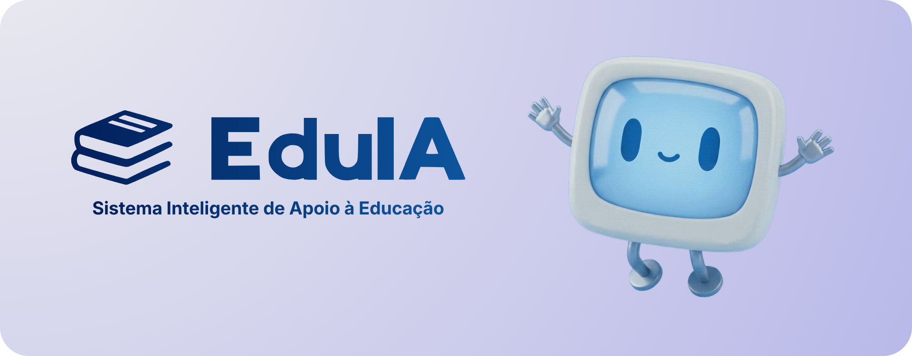
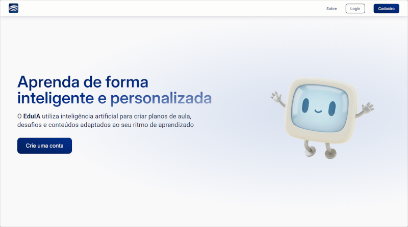
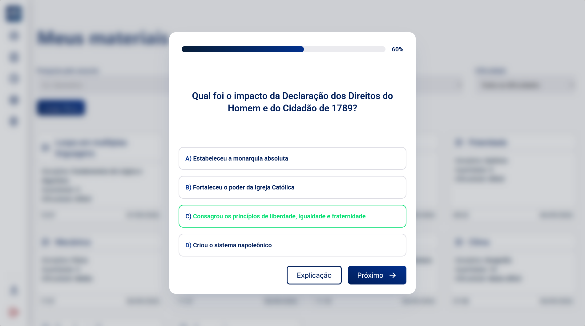

<div align='center'>
    
</div>

<div align='center'>
    
    
    
    
    
    
    
</div>

<p align='center'>
  <strong>EduIA</strong> - Geração inteligente de materiais de estudo para professores e alunos
</p>

## 📌 Visão geral

O **EduIA** é uma plataforma que usa Inteligência Artificial para auxiliar na criação de materiais didáticos personalizados, reduzindo o tempo de produção de conteúdos e tornando o processo de ensino-aprendizado mais dinâmico.

O projeto foi desenvolvido por estudantes do ensino médio técnico integrado do **IFRN – campus Caicó** e tem como objetivo automatizar a geração de atividades pedagógicas com qualidade, rapidez e adaptabilidade.

<figure align='center'>
    
    <figcaption>Landing page do sistema</figcaption>
</figure>

<figure align='center'>
    
    <figcaption>Página de cadastro</figcaption>
</figure>

<figure align='center'>
    
    <figcaption>Exemplo de questão gerada pelo sistema</figcaption>
</figure>

## ✨ O que o sistema gera

O EduIA pode criar diferentes tipos de materiais acadêmicos, como:

| Material               | Como funciona                                                                                              |
| ---------------------- | ---------------------------------------------------------------------------------------------------------- |
| **Questões**           | Listas de exercícios com quantidade e nível especificados pelo usuário                                     |
| **Formulários**        | Formulários com quantidade e nível especificados pelo usuário                                              |
| **Quiz**               | Quizzes com pontuação e tempo estabelecidos pelo usuário                                                   |
| **Flashcards**         | Cartões com perguntas simples e suas respostas                                                             |
| **Resumos**            | Resumo de um determinado assunto ou matéria                                                                |
| **Explicações**        | Explicação de um assunto ou matéria para diferentes níveis, podendo usar analogias e demonstrar aplicações |
| **Exercícios guiados** | Questões já respondidas, com passo a passo e explicações detalhadas                                        |
| **Planos de aula**     | Base do que deve ser abordado na aula em questão                                                           |
| **Roteiros de estudo** | Contém o que deve ser estudado e em qual sequência                                                         |
| **Desafios**           | Desafios para cada assunto ou matéria                                                                      |

## 🧠 Como funciona

A experiência parte da interface web, onde o usuário define o tipo de material, a disciplina, o nível de dificuldade e outros critérios. O backend reúne essas informações em um prompt específico para o material solicitado e o envia, com o auxílio do **LangChain**, ao modelo de linguagem configurado no Hugging Face. O modelo gera o conteúdo, e um parser valida e organiza a resposta em JSON para que o sistema possa utilizá-la.

O **RAG** (_Retrieval-Augmented Generation_, ou geração aumentada por recuperação) é uma técnica que complementa esse processo: antes de gerar a resposta, o sistema busca informações relevantes em uma base de documentos e inclui os trechos encontrados no contexto enviado ao modelo. Assim, a geração pode se apoiar em fontes específicas e atualizadas, em vez de depender apenas do conhecimento aprendido pelo modelo. A qualidade e a pertinência das fontes recuperadas influenciam o resultado. Veja mais em [Framework e LLM](docs/framework_e_llm.md).

Essa abordagem permite que o mesmo fluxo seja reutilizado para diferentes materiais e facilite futuras expansões do projeto.

## ⚙️ Stack tecnológica

<table>
    <thead>
        <tr>
            <th>Categoria</th>
            <th>Tecnologia</th>
            <th>Finalidade</th>
        </tr>
    </thead>
    <tbody>
        <tr>
            <td rowspan='2'>Backend</td>
            <td><strong>Python</strong></td>
            <td>Linguagem de programação usada no backend</td>
        </tr>
        <tr>
            <td><strong>Flask</strong></td>
            <td>API e lógica de negócio</td>
        </tr>
        <tr>
            <td rowspan='2'>Frontend</td>
            <td><strong>React</strong></td>
            <td>Biblioteca <strong>JavaScript</strong> usada no frontend</td>
        </tr>
        <tr>
            <td><strong>Vite</strong></td>
            <td>Ferramenta de desenvolvimento e construção</td>
        </tr>
        <tr>
            <td>Banco de dados</td>
            <td><strong>MySQL</strong></td>
            <td>Persistência e armazenamento</td>
        </tr>
        <tr>
            <td rowspan='2'>IA</td>
            <td><strong>LangChain</strong></td>
            <td>Orquestração da LLM</td>
        </tr>
        <tr>
            <td><strong>GPT-5 nano</strong></td>
            <td>Geração do conteúdo educacional</td>
        </tr>
        <tr>
            <td>Qualidade</td>
            <td><strong>Ruff, Prettier, Eslint</strong></td>
            <td>Padronização e lint</td>
        </tr>
        <tr>
            <td>Ambiente</td>
            <td><strong>UV, Docker</strong></td>
            <td>Dependências e execução em containers</td>
        </tr>
    </tbody>
</table>

> [!NOTE]
> A documentações completas de requisitos e decisões técnicas: [**Documentação**](#-documentação).

## 🚀 Pré-requisitos

Antes de executar o projeto, certifique-se de ter instalado:

- Python 3.12 ou superior
- Node.js 18+
- npm
- MySQL (para execução local)
- Docker e Docker Compose (opcional)

## 💻 Como executar o projeto

Há duas formas principais de rodar o EduIA:

- **🧑‍💻 modo desenvolvedor**: frontend e backend em execução separada
- **🐋 modo `Docker`**: execução em ambiente containerizado

### 🧑‍💻 Modo desenvolvedor

1. **Clone o repositório**

    ```bash
    git clone https://github.com/Davi-1903/EduIA.git
    cd EduIA
    ```

2. **Configure as variáveis de ambiente**

    Copie o arquivo de exemplo e ajuste os valores de acordo com o seu ambiente:

    ```bash
    cp .env.example .env
    ```

    Exemplo de configuração:

    ```env
    # ========================< API KEYS >========================
    PINECONE_API_KEY=<SUA-CHAVE-DE-API-DO-PINECONE>
    HUGGINGFACEHUB_API_TOKEN=<SUA-CHAVE-DE-API-DO-HUGGING-FACE>

    # =====================< Hugging Face >=====================
    HF_EMBEDDING_MODEL=<MODELO-DE-EMBEDDING>
    HF_MODEL=<MODELO-DE-IA>
    MAX_TOKENS=3000
    INDEX_NAME=eduia-rag

    # =====================< Autenticação >=====================
    SECRET_KEY=<SUA-CHAVE-SECRETA-AQUI>
    CORS_ORIGINS=http://localhost:3000,http://localhost:4173

    # ====================< Banco de dados >====================
    DB_USER=root
    DB_PASSWORD=<SENHA-DO-BANCO-DE-DADOS-AQUI>
    DB_HOST=localhost
    DB_PORT=3306
    DB_NAME=db_eduia
    TRASH_RETENTION_DAYS=30
    ```

3. **Instale as dependências**

    ```bash
    # Backend
    cd server
    uv sync
    # ou
    pip install -r requirements.txt

    # Frontend
    cd ../client
    npm install
    ```

    > Se houver conflitos de dependência no frontend, use: `npm install --legacy-peer-deps`

4. **Inicie os serviços**

    ```bash
    # Backend
    cd ../server
    flask run --debug

    # Frontend em outro terminal
    cd ../client
    npm run dev
    ```

    A aplicação estará disponível em:
    - frontend: http://localhost:3000
    - backend: http://localhost:5000

### 🐋 Modo Docker

1. **Configure o arquivo `.env`**

    O mesmo arquivo `.env` pode ser usado no modo Docker, com a diferença de que o host do banco dentro da rede do Compose é `database`.

2. **Suba os containers**

    ```bash
    docker compose up --build
    ```

    Isso inicia automaticamente:
    - frontend da aplicação
    - backend Flask
    - banco MySQL

    Após a inicialização, a interface fica disponível em:
    - http://localhost:3000

## 📚 Documentação

- [Projeto Integrador - EduIA](docs/Projeto%20Integrador%20-%20EduIA.pdf)
- [Requisitos Funcionais](docs/requisitos_funcionais.md)
- [Requisitos Não Funcionais](docs/requisitos_nao_funcionais.md)
- [Framework e LLM](docs/framework_e_llm.md)

## 👥 Equipe

| Nome                                              | Papel no projeto |
| ------------------------------------------------- | ---------------- |
| [Ana Cecilya](https://github.com/cecilya1)        | Desenvolvedora   |
| [Ana Clara](https://github.com/anaclaraa1)        | Desenvolvedora   |
| [Davi Francisco](https://github.com/Davi-1903)    | Desenvolvedor    |
| [Maria das Graças](https://github.com/mgdantas1)  | Desenvolvedora   |
| [Miguel Tavares](https://github.com/migueltvrs13) | Desenvolvedor    |
| [Romerito Campos](https://github.com/RoCampos)    | Orientador       |

## ⚖️ Licença

O sistema foi construído como projeto de pesquisa e extensão pelos alunos do **IFRN – campus Caicó**.

- [Licença MIT](LICENSE)
